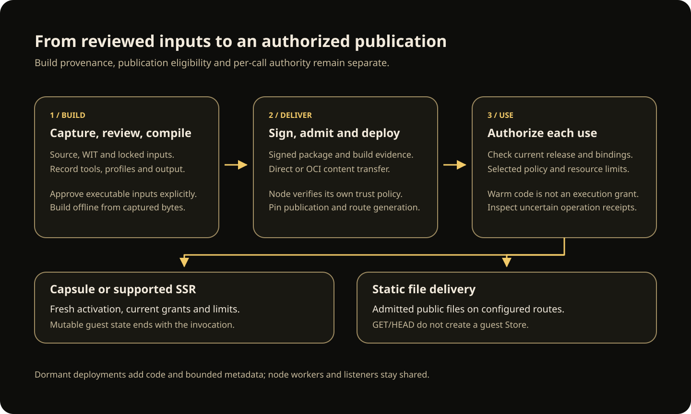
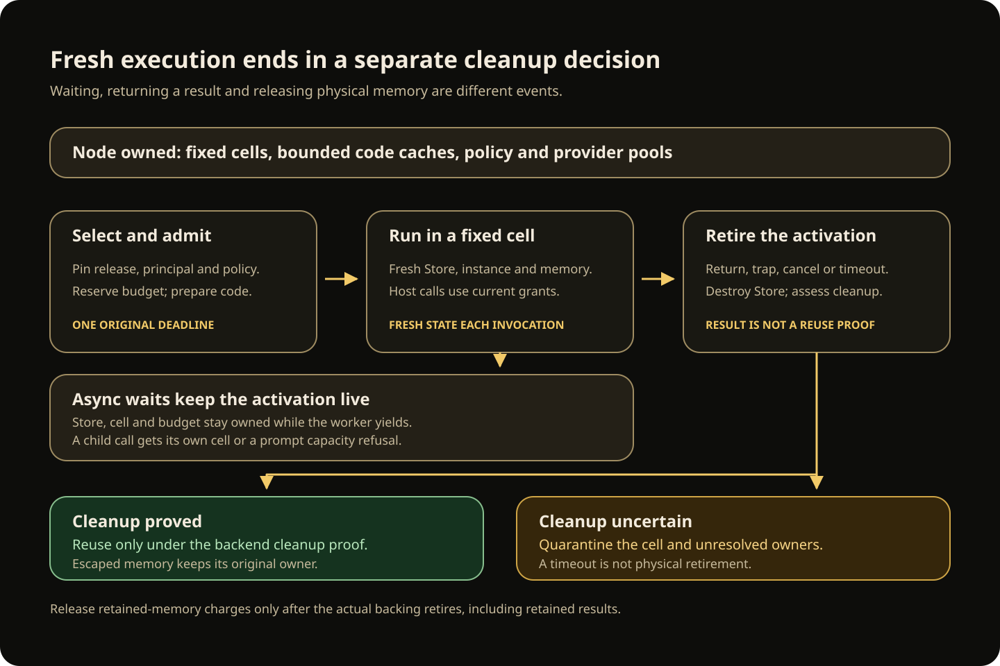
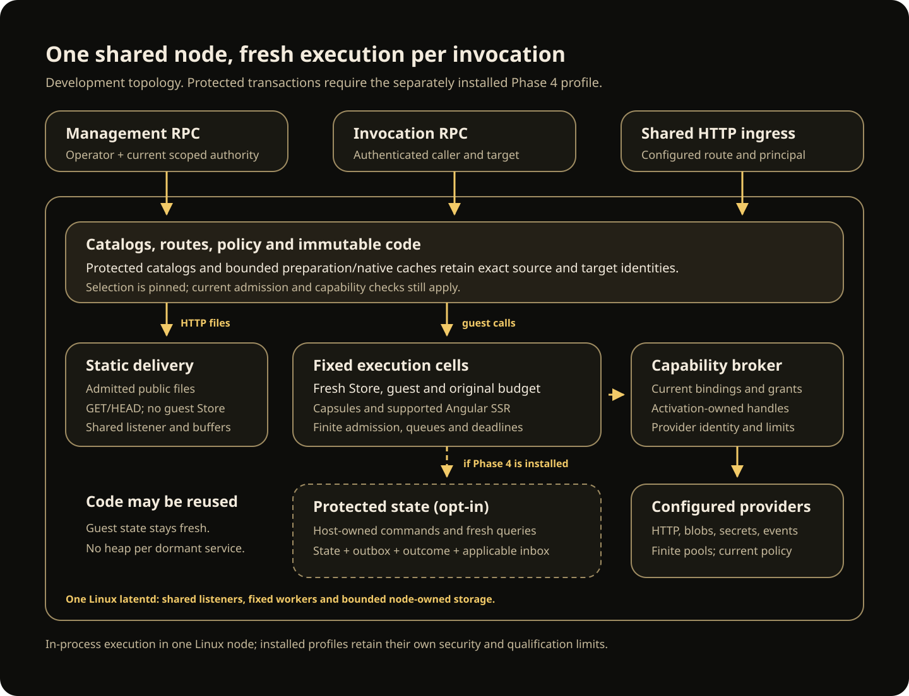

# LSF architecture overview

LSF runs service capsules on a standalone Linux node. A deployed
capsule is stored code, contracts and configuration. A request creates a
short-lived activation inside a fixed pool of sandboxed execution cells.
The node retires that activation's execution resources through explicit cleanup.

The current development implementation includes authenticated invocation and
management, package admission, rollout and recovery, capability providers,
shared HTTP ingress, static-site delivery and the supported Angular SSR profile.
An explicitly selected Phase 4 configuration also installs protected state,
transactional commands, fresh queries and durable deferred effects. Those
Development profiles have separate acceptance requirements and are not supplied
by the published alpha.5 toolkit. See [Changes since alpha.5](../start/development-changes.md).
See [Run your first node](../start/first-node.md) for a working local example.

## From source to service

[](../assets/package-delivery.svg)

[Open the delivery diagram at full size](../assets/package-delivery.svg).

Developer tooling builds a component or website and packages selected output.
Publisher signatures and build evidence accompany the immutable package.
An OCI registry can transfer those bytes. The node checks its own current trust
policy before admitting them; a registry account or local verification result
does not grant execution permission.

A deployment selects an admitted publication and its configuration. Calls select
a revision through the node's routing table. The node authenticates the caller,
checks admission and execution authority, and runs the selected component.
[Managed operations](../phase-2-operator-workflows.md) retain operation identities
for inspecting uncertain outcomes. [Rollout](../phase-2-rollouts.md) and
[rollback](../phase-2-rollback.md) publish new routes explicitly.

## Resource ownership

```text
resident ownership = fixed node services + bounded retained metadata/caches + active and retiring work
```

An inactive deployment owns no executing guest, dedicated process, operating
system thread, listener, guest heap, connection pool, timer loop or telemetry
exporter. Catalog, route and policy metadata can grow with deployment count
within configured bounds. Execution allocation follows active work.
Protected database caches, retained command/effect metadata and recovery
reservations also have finite node-owned budgets. Durable pending work can
outlive every activation without retaining a guest Store or cell. This ownership
model is not an RSS formula or a claim that durable state is free.

[](../assets/activation-lifecycle.svg)

[Open the activation diagram at full size](../assets/activation-lifecycle.svg).

Each invocation gets fresh guest state, a deadline and a budget. Capability
handles belong to that activation. Success, declared errors, traps,
cancellation and timeout all lead through cleanup. Cell reuse requires proof
that cleanup completed; uncertain cleanup keeps the cell quarantined and its
resources accounted for.

Cell reuse and memory reservation release are distinct. Safely detached result
buffers or selected native backing can outlive Store destruction while retaining
their original charges. The [physical ownership diagram](../runtime/resource-budgets.md#accounting)
shows those owners; their release does not rewind finalized consumption reports.

A fixed node cleanup supervisor keeps ownership after a client disconnects.
It does not create a worker for each disconnected caller. Node-wide audit,
rollout, provider and telemetry owners have finite capacity. Optional native
compilation runs a bounded temporary child process; a dormant service keeps no
compiler alive. Limits on stored bytes or reservations are separate from
measured process memory.

## Names you will encounter

| Name | Meaning |
| --- | --- |
| Service | A stable logical name that callers use. |
| Capsule | A Wasm component together with its callable WIT contracts. |
| Package | The exact manifest, configuration and payload bytes delivered together. |
| Publication | An admitted package identity with its current trust and lifecycle state. |
| Deployment | A selected publication and its execution, routing and capability configuration. |
| Revision | The exact deployment selection used by an invocation. |
| Activation | One invocation's input, identity, budget, deadline and temporary execution state. |

Transactions add stable command, attempt, commit and effect identities independent
of activation and route revision. Namespace incarnation identifies business
identity; schema and recovery epochs fence live views across migration and
older-history restore. See [state and effects](state-and-effects.md) and
[namespace history](namespace-history-epochs.md).

The [runtime identity guide](../learn/runtime-identities.md) explains how to keep
these identities distinct when deploying and recovering an application.

## Node responsibilities

[](../assets/standalone-architecture.svg)

[Open the shared-node diagram at full size](../assets/standalone-architecture.svg).

The enclosing node is one process. The conditional state path supplies the
host-owned command/query runtime; it is separate from ordinary capability
provider installation. Each installed profile retains its own security and
qualification boundary.

**Build and delivery tooling** compiles sources, records build inputs, packages
output and transfers content. Package assembly itself does not run arbitrary
build scripts or invent signatures and provenance.

**Management services** maintain the local catalogs, validate current authority,
compile grants and bindings, and atomically publish route snapshots. Deployment,
rollout and audit receipts support explicit recovery after an uncertain reply.

**Execution services** authenticate calls, select revisions, enforce admission
and scheduling, prepare components and create fresh activations. Calls into
providers check current grants, bindings, provider identity and remaining budget.
See [capability bindings](../runtime/capability-bindings.md) and
[activation lifecycle](../activation-lifecycle.md).

## Providers and browser delivery

The runtime has HTTP, streaming HTTP, immutable blob, secret, event, local-call,
randomness and custom-metric integrations. The
[standalone provider configuration](../reference/standalone-providers.md)
installs buffered/streaming HTTP, local immutable blobs, activation clocks,
OS-backed randomness, context/logging, protected local secrets, custom metrics,
local calls and immediate NATS publication through explicit configuration,
bindings and grants. The optional activation-runtime bridge has its own finite
ownership limits. S3 and Vault still use trusted Rust embedding; development TCP
streams require their separate build feature and qualification gates. The
provider schema and installed profile determine availability, not the presence
of a crate or an inspected import.

The shared [HTTP ingress](../reference/http-ingress.md) handles configured
application routes with bounded request and response ownership. A
[static site](../component-development/static-sites.md) serves admitted public
files without executing a guest. The supported
[Angular renderer](../component-development/angular-build.md) runs inside a
component activation and supplies server-rendered HTML alongside browser assets.
This profile does not run a general Node.js server or arbitrary npm middleware.

## Current topology and limits

A standalone deployment uses one Linux `latentd` process, durable local storage,
fixed runtime and control workers, and configured shared listeners. External
clients use authenticated RPCs; browsers use the configured HTTP ingress.
Optional external provider services and an OCI registry have their own owners.
The node does not run a process or open a port for each deployed capsule.

The [protected state/effect runtime](state-and-effects.md) commits staged state,
intents and original outcomes atomically under its selected namespace and current
authority. Commands, fresh queries, result recovery and effect dispatch have
separate owners; a completed HTTP call or event publication is not a universal
exactly-once transaction. Its collective, application and packaged gates remain
open. Cluster placement and durable workflows remain planned. Stronger isolation through separate
guest execution processes is also not part of the current cell model.

For configuration, use the [node reference](../reference/standalone-node.md).
For a design rationale, use the [architecture decisions](../../adr/README.md).
The complete [architecture index](../../ARCHITECTURE.md) includes schema,
retention, protected recovery and the planned cluster handoff.
Contributors can find historical measurements and their tested scope in the
[validation guide](../../VALIDATION.md).
